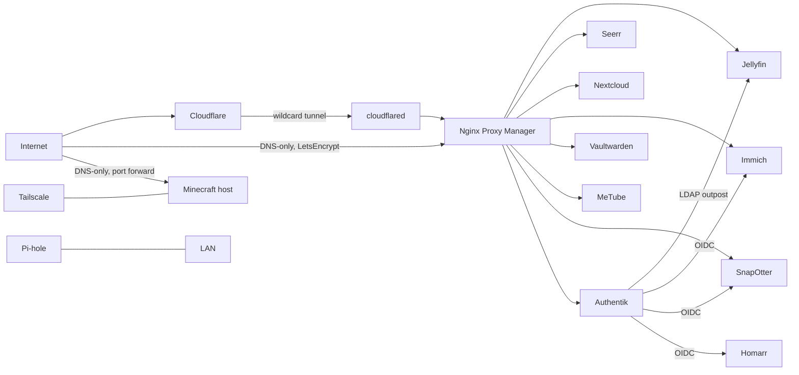

# Homelab

Self-hosted services on Ubuntu with Docker Compose, plus a separate mini PC that runs Minecraft. Web apps are published through a Cloudflare Tunnel into Nginx Proxy Manager (NPM); a few records are DNS-only because they need direct ports.

> Secrets are **not** in this repo. Each stack has a `.env.example`; copy it to `.env` and fill in your own values. `<domain>` stands for the real domain.

## Architecture



- **Ingress:** a single Cloudflare wildcard tunnel (`cloudflared`) routes to NPM (stack in `tunnel/`). The previous Caddy reverse proxy has been retired.
- **DNS-only records:** `files` and `photos` bypass the tunnel and are served directly by NPM with Let's Encrypt certificates. `mc`, `create` and the Minecraft SRV record point at the Minecraft host. A Cloudflare DDNS container keeps `create`, `mc`, `files` and `photos` current.
- **LAN DNS:** Pi-hole, handed out through the router's DHCP settings (TP-Link Deco X50-5G on 5G internet).
- **Admin access:** Tailscale (started with `--accept-dns=false` so MagicDNS doesn't break container DNS). The Crafty panel is only reachable over Tailscale.
- **Identity:** Authentik provides OIDC logins and an LDAP outpost for Jellyfin.

## Public hostnames

| Subdomain | Service | Reached via |
|---|---|---|
| `jellyfin.<domain>` | Jellyfin | Cloudflare Tunnel |
| `requests.<domain>` | Seerr | Cloudflare Tunnel |
| `vault.<domain>` | Vaultwarden | Cloudflare Tunnel |
| `so.<domain>` | SnapOtter | Cloudflare Tunnel |
| `download.<domain>` | MeTube | Cloudflare Tunnel |
| `auth.<domain>` | Authentik | NPM |
| `files.<domain>` | Nextcloud | DNS-only, direct to NPM |
| `photos.<domain>` | Immich | DNS-only, direct to NPM |
| `mc.<domain>` | Minecraft (Paper) | DNS-only, port forward |
| `create.<domain>` | Minecraft (NeoForge modpack, port 25566) | DNS-only + SRV record |

## Single sign-on

| App | Method | Status |
|---|---|---|
| Jellyfin | LDAP (Authentik outpost + LDAP-Auth plugin) | Working |
| SnapOtter | OIDC | Working |
| Immich | OAuth/OIDC | Working |
| Homarr | OIDC | In progress |

## Storage

| Path | Used for |
|---|---|
| `/mnt/das` (ext4 DAS) | Media library (`media/movies`, `tv`, `audiobooks`, `ebooks`), MeTube downloads, SnapOtter data, Vaultwarden backups |
| `/mnt/photos` | Immich library |
| `/mnt/nextcloud/data` | Nextcloud files |
| `~/media/torrents` (internal SSD) | Download cache; imports to the DAS use copy-then-delete |

## Hosts

| Host | Role |
|---|---|
| Main server (Ubuntu) | Everything in the stacks table below, including the NVIDIA GPU used for Immich machine learning |
| Mini PC (Dell OptiPlex, i5-12500T, 16 GB, 512 GB NVMe) | Minecraft via Crafty Controller in Docker: a Paper server and a NeoForge modpack server ("All of Create Aeronautics") |

## Stacks and services (main server)

| Stack (dir) | Services | Host ports | Notes |
|---|---|---|---|
| `media-stack` | Jellyfin, Seerr, Sonarr, Radarr, Prowlarr, Bazarr, qBittorrent, FlareSolverr, Chaptarr, Maintainerr, Audiobookshelf, Homarr, Mumble | 8096, 5055, 8989, 7878, 9696, 6767, 8080 + 6881, 8191, 8789, 6246, 13378, 7575, 64738 | Network `media-stack_default` |
| `immich` | Immich server, machine learning (CUDA), Postgres, Redis | 2283 | Network `immich_default` |
| `authentik` | Server, worker, Postgres, LDAP outpost | 9000, 9443, 389, 636 | Currently defined in the Immich compose file |
| `nextcloud` | Nextcloud, MariaDB, Redis | none (behind NPM) | Background jobs run in Cron mode |
| `tunnel` | cloudflared, Nginx Proxy Manager | 80, 81, 443 | Network `proxy` joins the app networks |
| `cloudflare-ddns` | favonia/cloudflare-ddns | none | Host network |
| `vaultwarden` | Vaultwarden | none (behind NPM) | Nightly `backup.sh` |
| `metube` | MeTube (yt-dlp UI) | none (behind NPM) | Uses yt-dlp nightly for Instagram |
| `snapotter` | SnapOtter, Postgres, Redis | 1349 | OIDC via Authentik |
| `speedtest-tracker` | Speedtest Tracker | 8082 | |
| `pihole` | Pi-hole | 53, 8081, 8443 | |
| (standalone) | Dashdot, ctop | 3001 | Run outside compose |

The `crafty` folder in this repo is the Crafty Controller compose for the mini PC. The copy on the main server is stopped.

## Calendar

Nextcloud Calendar is the main calendar, with an external school schedule subscribed as an `.ics` feed. Homarr reads Nextcloud through its CalDAV endpoint (`https://files.<domain>/remote.php/dav`).

## Scheduled jobs

| When | What |
|---|---|
| every 5 min | Nextcloud `cron.php` inside the container (user crontab) |
| daily 03:00 | Vaultwarden backup (`backup.sh`, root crontab) |

## Backups

- **Vaultwarden:** nightly backup to `/mnt/das`, copied to Nextcloud with an rclone WebDAV remote.
- **Databases (Authentik, Nextcloud, Immich):** no dump jobs yet. See TODO.

## Layout

```
homelab/
├── README.md
├── docs/
├── media-stack/
├── immich/
├── authentik/
├── nextcloud/
├── tunnel/
├── cloudflare-ddns/
├── vaultwarden/
├── metube/
├── snapotter/
├── speedtest-tracker/
├── pihole/
└── crafty/
```

## Bring-up

```bash
cd <stack>
cp .env.example .env   # fill in values
docker compose up -d
```

Create the `proxy` network and start `tunnel` first when rebuilding from scratch.

## TODO

- [ ] Clean up router port forwards (keep only 80/443 and the Minecraft ports)
- [ ] Split Authentik into its own compose project
- [ ] Add DB dump jobs for Authentik, Nextcloud (and verify Immich's)
- [ ] Bind LDAP (389/636) to localhost
- [ ] Finish Homarr OIDC login
- [ ] Replace placeholder bind-mount paths in Bazarr/Chaptarr
- [ ] 
