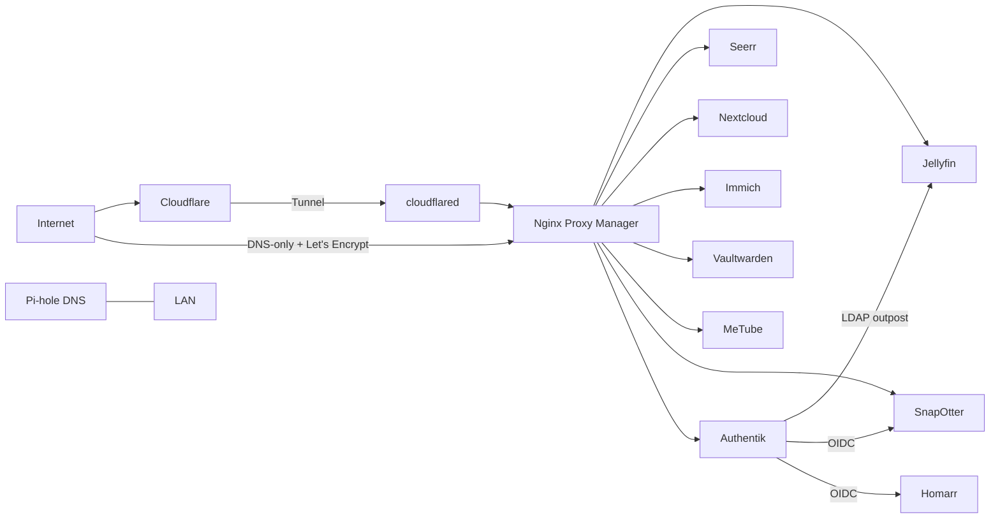

# Homelab

Self-hosted services running on a single Ubuntu host with Docker Compose. Public access goes through a Cloudflare Tunnel into Nginx Proxy Manager; a few services are DNS-only because they need direct ports.

> Secrets are **not** in this repo. Each stack has a `.env.example`; copy it to `.env` and fill in your own values.

## Architecture



- **Ingress:** Cloudflare wildcard tunnel to NPM (`cloudflared` + `npm`, stack in `tunnel/`). `files` and `photos` (and the Minecraft records) are DNS-only, kept current by a Cloudflare DDNS container.
- **DNS:** Pi-hole handles LAN DNS/DHCP DNS.
- **Identity:** Authentik (OIDC for web apps, LDAP outpost for Jellyfin).
- **Remote access:** Tailscale (`--accept-dns=false` so MagicDNS doesn't break container DNS).

## Storage

| Path | Used for |
|---|---|
| `/mnt/das` (ext4 DAS) | Media library (`media/movies`, `tv`, `audiobooks`, `ebooks`), MeTube downloads, SnapOtter data, Crafty |
| `/mnt/photos` | Immich library |
| `/mnt/nextcloud/data` | Nextcloud files |
| `~/media/torrents` (internal SSD) | Download cache (copy-then-delete import to the DAS) |

## Stacks and services

| Stack (dir) | Services | Host ports | Notes |
|---|---|---|---|
| `media-stack` | Jellyfin, Seerr, Sonarr, Radarr, Prowlarr, Bazarr, qBittorrent, FlareSolverr, Chaptarr, Maintainerr, Audiobookshelf, Homarr, Mumble | 8096, 5055, 8989, 7878, 9696, 6767, 8080 + 6881, 8191, 8789, 6246, 13378, 7575, 64738 | Network `media-stack_default` |
| `immich` | Immich server, machine learning (CUDA), Postgres (vectorchord), Redis | 2283 | Network `immich_default` |
| `authentik` | Server, worker, Postgres, LDAP outpost | 9000, 9443, 389, 636 | Currently defined in the Immich compose file |
| `nextcloud` | Nextcloud, MariaDB, Redis | none (behind NPM) | Cron every 5 min for background jobs |
| `tunnel` | cloudflared, Nginx Proxy Manager | 80, 81, 443 | Network `proxy` joins the app networks |
| `cloudflare-ddns` | favonia/cloudflare-ddns | none | Host network |
| `vaultwarden` | Vaultwarden | none (behind NPM) | Nightly `backup.sh` at 03:00 |
| `metube` | MeTube (yt-dlp UI) | none (behind NPM) | |
| `snapotter` | SnapOtter, Postgres, Redis | 1349 | OIDC via Authentik |
| `speedtest-tracker` | Speedtest Tracker | 8082 | |
| `pihole` | Pi-hole | 53, 8081, 8443 | |
| `crafty` | Crafty Controller (Minecraft) | (see compose) | Currently stopped |
| (standalone) | Dashdot (3001), ctop | 3001 | Run outside compose |

## Scheduled jobs

| When | What |
|---|---|
| every 5 min | Nextcloud `cron.php` inside the container |
| daily 03:00 | Vaultwarden backup (`backup.sh`) |

## Backups

Current state: Vaultwarden has a nightly backup script. Databases for Authentik, Immich and Nextcloud do not have their own dump jobs yet. See TODO.

## Layout

```
homelab/
├── README.md
├── docs/
├── media-stack/
├── immich/
├── authentik/
├── nextcloud/
├── tunnel/
├── cloudflare-ddns/
├── vaultwarden/
├── metube/
├── snapotter/
├── speedtest-tracker/
├── pihole/
└── crafty/
```

## Restore / bring-up

```bash
cd <stack>
cp .env.example .env   # fill in values
docker compose up -d
```

Start `tunnel` and the networks it joins first if you are rebuilding from scratch.

## TODO

- [ ] Split Authentik into its own compose project
- [ ] Add DB dump jobs for Authentik, Nextcloud (and verify Immich's)
- [ ] Clean up router port forwards (keep only 80/443 and Minecraft)
- [ ] Bind LDAP (389/636) to localhost
- [ ] Replace placeholder bind-mount paths in Bazarr/Chaptarr
- [ ] 
